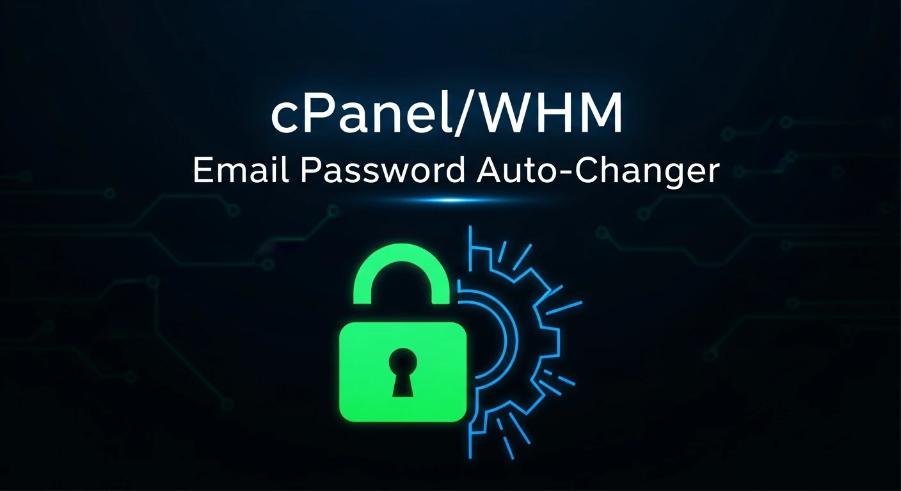

# cPanel/WHM Email Password Auto-Changer 🔐

Readme: [EN](README.md)

 



Um script em Bash simples e eficiente para automatizar a alteração de senhas de contas de e-mail diretamente via linha de comando (SSH) em servidores WHM/cPanel.

Desenvolvido para facilitar a rotina de administradores de infraestrutura e suporte N2/N3, permitindo a troca rápida de senhas sem a necessidade de navegar pela interface gráfica do cPanel.

## 🚀 Funcionalidades

* **Geração Segura de Senhas:** Utiliza `openssl` para gerar senhas fortes de 16 caracteres.
* **Formatação Alfanumérica:** A senha gerada contém apenas letras e números, evitando problemas de formatação e login em clientes de e-mail mais antigos ou incompatíveis com caracteres especiais.
* **Validação de Entrada:** Verifica automaticamente se o formato do e-mail é válido e se não está em branco.
* **Verificação de Domínio e Usuário:** Checa se o domínio resolve localmente, se está cadastrado no servidor (`/etc/trueuserdomains`) e identifica o proprietário automaticamente via `/scripts/whoowns`.
* **Uso da API Nativa:** Utiliza o comando `uapi` oficial do cPanel, garantindo que a alteração seja feita de forma limpa e sem falhas (evitando *parsing* frágil de arquivos internos).

## 🛠️ Pré-requisitos

Para que o script funcione corretamente, você precisa de:

* Acesso SSH ao servidor com privilégios de `root` (necessário para ler `/etc/trueuserdomains` e executar `/scripts/whoowns`).
* Servidor rodando **WHM/cPanel**.
* Pacote `openssl` instalado (nativo na maioria das distribuições Linux).

## 📥 Instalação [Modo hospedado]

1. **Baixe o arquivo no servidor:**

```bash
curl -O https://raw.githubusercontent.com/sr00t3d/cpanel-changemail-pass/refs/heads/main/cp-changemail-pass.sh
```

2. **Dê permissão de execução:**

```bash
chmod +x cp-changemail-pass.sh
```

3. **Execute o script:**

```bash
./cp-changemail-pass.sh
```

## 💻 Como usar

### Modo hospedado

Execute o script passando o endereço de e-mail completo como parâmetro:

```bash
./cp-changemail-pass.sh mail@dominio.com
```

### Modo direto

```bash
bash <(curl -fsSL 'https://raw.githubusercontent.com/sr00t3d/cpanel-changemail-pass/refs/heads/main/cp-changemail-pass.sh') mail@dominio.com
```

Exemplo de Saída (Sucesso):

```bash
Domain seudominio.com.br is registered on the server

Password for the email address mail@dominio.com successfully changed, see the details below:

Email: mail@dominio.com
Password: aB3dE5fG7hI9jK1l
```

Exemplo de Saída (Erro)

```bash
Se o e-mail não existir ou o formato for inválido, o script interromperá a execução com um alerta claro:

[!] - The email mail@dominio.com does not exist on the server.
```

## ⚠️ Aviso Legal

> [!WARNING]
> Este software é fornecido "tal como está". Certifique-se sempre de ter permissão explícita antes de executar. O autor não se responsabiliza por qualquer uso indevido, consequências legais ou impacto nos dados causados ​​por esta ferramenta.

## 📚 Detailed Tutorial

Para um guia completo, passo a passo, confira meu artigo completo:

👉 [**Mudança rápida de senha de e-mail do cpanel**](https://perciocastelo.com.br/blog/quick-change-cpanel-email-password.html)

## Licença 📄

Este projeto está licenciado sob a **GNU General Public License v3.0**. Veja o arquivo [LICENSE](LICENSE) para mais detalhes.